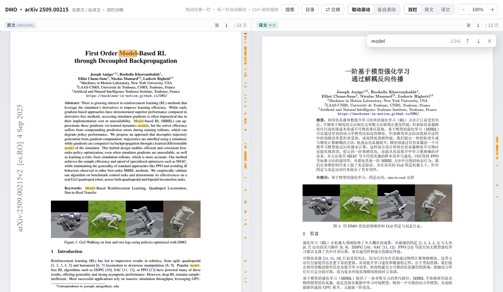
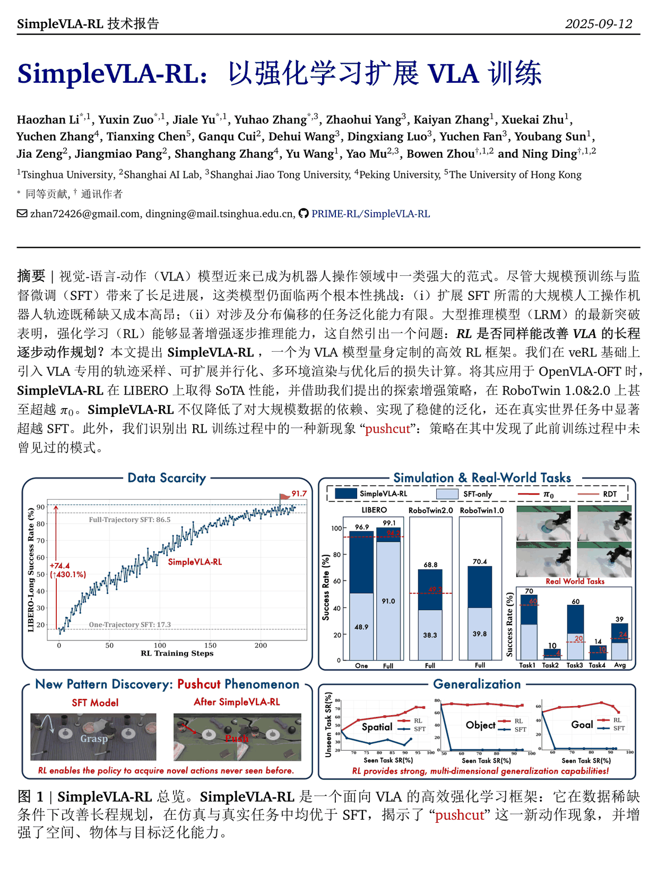
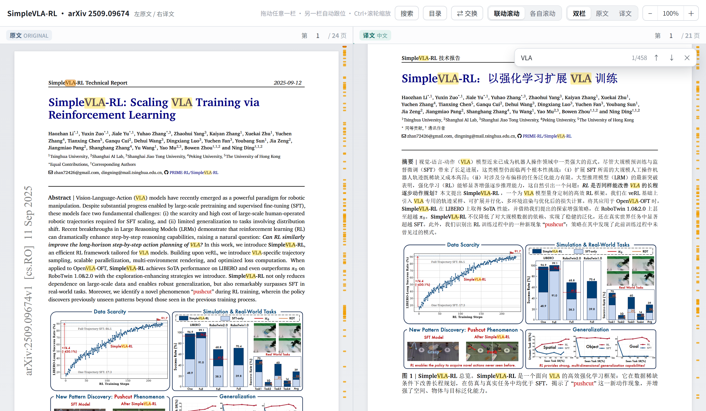
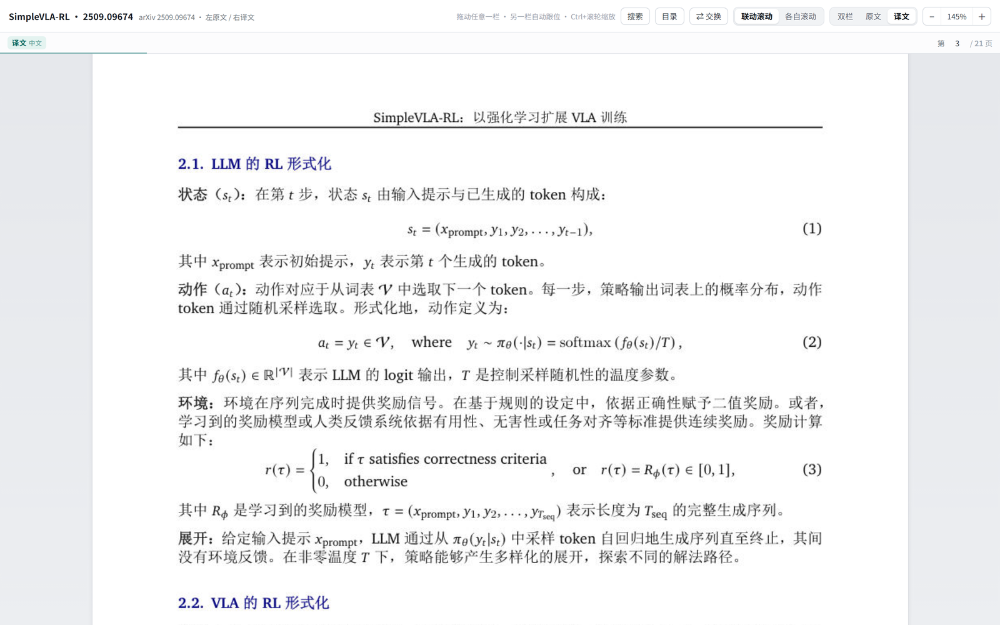
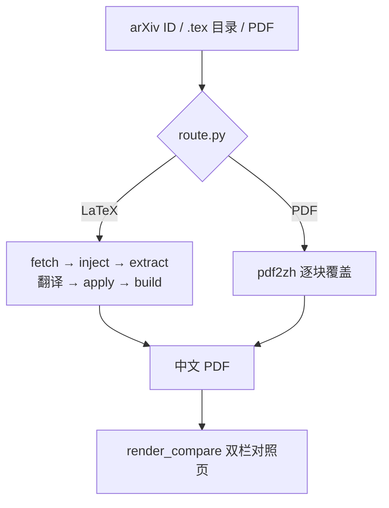

<p align="center">
  <picture>
    <source media="(prefers-color-scheme: dark)" srcset="assets/icon.png">
    
  </picture>
</p>

<h1 align="center">arxiv-zh-tex</h1>

<p align="center">
  把 arXiv 论文翻成中文，<b>公式、图表、编号、交叉引用、参考文献全部留在原位</b>。
</p>

<p align="center">
  <a href="LICENSE"></a>
  
  
  
</p>

<p align="center">
  <a href="#安装">安装</a> ·
  <a href="#两条分支">两条分支</a> ·
  <a href="#对照页">对照页</a> ·
  <a href="#快速开始">快速开始</a> ·
  <a href="#latex-兼容性">兼容性</a> ·
  <a href="#已知限制">已知限制</a>
</p>



<p align="center">
  <sub><i>DMO（arXiv 2509.00215）的真实产出，截自最终版对照页：左 22 页原文 / 右 21 页中文，
  逐页对照、按节自动对齐；页面由 pdf.js 现渲，搜 <code>model</code> 双栏共 141 处命中。截图未经修饰。</i></sub>
</p>

一个 WorkBuddy / Claude Skill 形态的工程化流水线：输入是 arXiv ID、`.tex` 目录或一份 PDF，
输出是**可重编译的中文 PDF**，外加一个「左原文 / 右译文」的页面对照网页。

## 译出来是什么样

<p align="center">
  
</p>

<p align="center">
  <sub>编译产物的第 1 页（A4）：标题、摘要、图注已译；图 1 直接引用原工程的图文件，<br>
  不是截图重画。图内英文标注按设计保留——要让图里也变中文，只能重画。</sub>
</p>

- **排版不动**：在原作者自己的类文件里换字，不另起炉灶重排。图、表、编号、`\ref` 的指向都跟原文一致。
- **公式不动**：模型看到的是 `⟪P0001⟫` 这样的占位标记，回填时只替换标记内的自然语言。数学符号没有机会被写坏。
- **可以核对**：每一段译文都记着它来自哪个源片段；`audit.py` 给出页数、中文覆盖率、图表数量，`check_coverage.py` 在翻译前找出「根本没被抽到的正文」，`check_tr.py` 找出缺译和成片英文。

## 两条分支

| 输入 | 分支 | 产物 | 质量 |
|---|---|---|---|
| arXiv ID / abs、pdf 链接 / `.tex` 目录 / `.zip` `.tar.gz` | **LaTeX**（主链） | 重新编译的中文 PDF | 公式、编号、交叉引用都是真 LaTeX，上限最高 |
| 只有 `.pdf`：期刊排版、arXiv 没放源码 | **PDF**（pdf2zh） | `<论文>_中文版.pdf` | 版式 1:1 保留，公式是原图 |

`route.py` 负责判断走哪条；`--mode latex|pdf` 可以强制指定。
两条分支最后都能接 `render_compare.py` 出双栏对照页。

> **PDF 分支不是 OCR。** 它读的是 PDF 的文字层（矢量文本 + 位置），逐块翻译后按原 bbox
> 覆盖回去。扫描件（纯图片 PDF）没有文字层，必须先做 OCR——不在本技能范围内。

## 对照页

`render_compare.py` 把两份 PDF 原样逐页并排呈现。页数不一致是正常的（中文字距紧、
行距小，22 页对 21 页），靠书签锚点让「同一节」对齐，而不是「同一页」。

页面不是图片，是把 PDF 交给浏览器里的 **pdf.js 现渲**：canvas 位图尺寸按
「CSS 宽 × devicePixelRatio」实时算，缩放一次重绘一次，所以 100% 锐、放大到 400% 一样锐，
和 Chrome 自带 PDF 阅读器同一条路线。只渲视口附近的页，离远了释放位图，43 页也不吃内存。
`file://` 双击就能用：worker 走 Blob URL，避开跨源限制。



<p align="center">
  <sub><code>Ctrl/⌘+F</code> 搜 <code>VLA</code>：命中按真实字形边界画框（当前项橙色、其余淡黄），中英混排也不偏移；滚动条旁有命中刻度。截图是双栏视图，共 458 处。</sub>
</p>

页面由 pdf.js 在浏览器里现渲，所以 Ctrl+F 之外还能直接划选正文；搜索索引则是另存的一份
「每页每行每词 + 逐字符横坐标」的 `META`，前端做子串匹配——它是真的「搜得到、看得见」：

- **命中框精确到字**：按真实字形边界画框，不是整行横带。混排词（`SimpleVLA-RL:`、中文夹 `VLA`）
  也不会偏——每个词都带词内逐字符的起点坐标，而不是按字数在词框里均分。
- **划选 / 复制**：canvas 上叠了一层透明文字层，拖选、双击选词、`Ctrl+C` 都能用，
  复制出来是文字不是图。只给文字开 `pointer-events`，空白处照样双击放大、拖动平移。
- **只搜当前栏**：单栏视图就只搜这一栏，双栏两边都搜，切视图命中自动重算——不会把视图切走。
- **命中计数与刻度**：`1/458` 这样的计数，加上滚动条旁的刻度条，长论文里能看出命中散落在哪。
- **联动 / 各自滚动**：拖动任意一栏，另一栏按锚点插值跟位。
- **浏览器式缩放**：`Ctrl/⌘ + 滚轮` 以指针为锚点、空白处双击 100%↔220%、双指捏合，40%–400%。
- **快捷键**：目录跳转、页码输入、`[`/`]` 翻页、`L` 联动、`F`/`0` 复位、`⇄` 交换左右。



<p align="center">
  <sub>单栏视图（「译文」按钮）：公式 (1)(2)(3) 是真 LaTeX 数学而不是截图，术语与符号沿用原文。</sub>
</p>

## 核心原则：模型永远不生成 TeX 语法

源码被切成自然语言片段，公式、命令、引用、数值替换成 `⟪P0001⟫` 这样的标记交给模型；
回填时只替换片段内的文字，标记还原成原文。以图注为例（`⟪P0001⟫` = `\caption{`，
`⟪P0002⟫` = `}`，标记在片段内从 1 开始编号）：

```latex
源码      \caption{We train a VLA policy on 20k trajectories.}
模型看到  ⟪P0001⟫We train a VLA policy on 20k trajectories.⟪P0002⟫
回填之后  \caption{我们在 2 万条轨迹上训练 VLA 策略。}
```

公式和结构因此从根本上不可能被改坏。产出是**纯中文版**（不是中英混排）；图里烧死的英文、
代码清单、参考文献条目一律不译。

## 流水线



## 安装

```bash
git clone https://github.com/hellow-world-collab/paper-translation-skill.git \
  ~/.workbuddy/skills/arxiv-zh-tex
```

**目录名必须是 `arxiv-zh-tex`**——SKILL.md 里的命令按这个路径写。Claude Code 用户把
`~/.workbuddy/skills` 换成 `~/.claude/skills` 即可。

LaTeX 分支除了 XeLaTeX 没有别的依赖；没装的话 Agent 会先自检、按你的系统装好（见下文「依赖」）。
PDF 分支要单独建环境（几百 MB，只建一次）：

```bash
python ~/.workbuddy/skills/arxiv-zh-tex/scripts/pdf_mode.py --project . --install
```

不确定环境齐不齐，先跑一句自检（缺什么会连安装命令一起打印）：

```bash
python ~/.workbuddy/skills/arxiv-zh-tex/scripts/env_check.py
```

也可以在对话里直接说「装一下 https://github.com/hellow-world-collab/paper-translation-skill，
目录名用 arxiv-zh-tex」，Agent 会 clone 到正确位置。

## 快速开始

```bash
S=~/.workbuddy/skills/arxiv-zh-tex/scripts

# 0) 先分流
python $S/route.py 2508.08241                    # 打印判定结果和下一步命令

# 1) LaTeX 分支
python $S/fetch.py          2508.08241 --out ./2508.08241
python $S/preflight.py      ./2508.08241
python $S/inject_cjk.py     ./2508.08241
python $S/extract.py        ./2508.08241
python $S/check_coverage.py ./2508.08241          # 翻译前查未抽取正文，必须清零
#      ↓ 翻译：按字符预算读一批 → 写 batch.tsv → 一次提交（约 5 批）
python $S/pending.py        ./2508.08241 --budget 18000
python $S/submit.py         ./2508.08241 batch.tsv
python $S/apply.py          ./2508.08241
python $S/check_tr.py       ./2508.08241
python $S/build.py          ./2508.08241
python $S/audit.py          ./2508.08241 --png

# 对照页要用「原文 PDF」，fetch 只下源码，这一步得自己抓一次
curl -L -o ./2508.08241/.arz/original_arxiv.pdf https://arxiv.org/pdf/2508.08241
python $S/render_compare.py --root ./2508.08241 \
    --original .arz/original_arxiv.pdf --translated out/main.pdf \
    --out html/compare
# 需要「一个文件发给别人」才加 --single-file "论文_双栏对照.html"

# 2) PDF 分支（没有源码 / 用户指定）
python $S/pdf_mode.py 论文.pdf --project ./论文 --compare
python $S/pdf_mode.py https://arxiv.org/pdf/2509.09674 --project ./x --compare
python $S/pdf_mode.py 论文.pdf --project ./x --check      # 只体检，不翻译
```

装完想确认环境没坏，跑一次自检（会真实编译 12 个小工程，约 5–10 分钟）：

```bash
python ~/.workbuddy/skills/arxiv-zh-tex/tests/run_compat.py --full
```

## 目录结构

```
SKILL.md                 技能主文档（流程、命令、踩坑表）
glossary.tsv             术语表：建议译名（可按论文语境偏离，不是硬约束）
scripts/
  route.py               第零步：判断 LaTeX / PDF 分支
  fetch.py               取源码（e-print）、认主文件 → manifest.json
  preflight.py           基线编译 + xetex 探测
  inject_cjk.py          注入中文字体（带哨兵验证）
  extract.py             切段、抽标记 → segments.json
  apply.py               回填译文 → 新的 .tex
  check_coverage.py      翻译前的抽取覆盖率检查（找出没进 segments 的英文正文）
  check_tr.py            译文体检（缺译 / 中文过少 / 成片英文 / 未抽取正文）
  submit.py              批量提交译文（TSV / JSON、原子写入、术语表建议仅提示）
  build.py               编译（内部先跑 check_tr，交叉引用收敛即停）
  audit.py               产物审计（页数、中文覆盖率、图表数量、参考文献）
  render_html.py         段落级重排网页（旧版，可选）
  render_compare.py      页面级对照页（左原文 / 右译文，pdf.js 现渲）
  pdf_mode.py            PDF 分支：建 .venv-pdf、调翻译器、接对照页
  pdf_translate.py       PDF 分支的翻译器（直接调 pdf2zh，不依赖外部技能）
  pending.py             待译片段清单（--budget 按字符量切批）
  env_check.py           环境自检：xelatex / pdftoppm / pymupdf / Python 版本
  package_market.py      打技能市场包（压平 KaTeX、剔开发资源、自检层级与体积）
  _common.py             路径、原子写、JSON 读写、编译参数
assets/
  compare_template.html  对照页模板
  katex/                 KaTeX（离线渲染公式用）
docs/images/             README 截图（真实产出，不是效果图）
rules/
  packages.yaml          宏包级 / 源码级坑与自动修法
  papers-2508.08241.md   单篇论文的特殊处理记录（摊平，市场包只收两级目录）
tests/
  run_compat.py          兼容性自检：12 个最小工程跑通全流程
  cases/                 每个 case 一个易翻车的写法
```

工程里的中间产物都在 `.arz/`：`manifest.json`（主文件与结构）、`segments.json`（原文片段 +
标记位置）、`translations.json`（译文）、`check_tr.json`、`audit.md`（审计报告）。

## 依赖

| 组件 | 用途 | 缺了会怎样 |
|---|---|---|
| **XeLaTeX**（TeX Live / MiKTeX） | 编译中文 PDF，LaTeX 分支的核心 | 直接跑不了 |
| `pdftoppm`（poppler） | 审计出图、双栏对照页 | 能编译，图出不来 |
| `pymupdf` | 渲染 HTML 阅读页 | 只影响 HTML，不影响 PDF |
| Python **3.10–3.12** | PDF 分支（`pdf2zh` 要求 `<3.13`） | 3.13 装不上，要单独建环境 |

按系统一条命令装齐：

```bash
# Windows（PowerShell）
winget install --id MiKTeX.MiKTeX -e
winget install --id oschwartz10612.Poppler -e

# macOS
brew install --cask basictex && brew install poppler
sudo tlmgr install xetex ctex

# Debian / Ubuntu
sudo apt install texlive-xetex texlive-lang-chinese texlive-latex-extra latexmk poppler-utils
```

> Windows 上 MiKTeX 装完通常不在 PATH，把 `%LOCALAPPDATA%\Programs\MiKTeX\miktex\bin\x64` 加进去，
> 或在新终端里重试。**这些 Agent 也会自己跑**：SKILL.md 第 -1 步就是环境自检，缺 XeLaTeX 它会
> 按平台装好再开工，不需要你提前配。

细节：

- 中文字体：Windows 用 SimSun/微软雅黑，Linux 用 Fandol 或 Noto CJK。
- **PDF 分支**：首次跑 `python scripts/pdf_mode.py . --install` 会自动建 `.venv-pdf` 并装好钉死版本
  `pdf2zh==1.9.11`、`tencentcloud-sdk-python-tmt==3.0.1478`。
  翻译器是仓库自带的 `scripts/pdf_translate.py`，**不需要**另外安装 `pdf-formula-translate` 技能
  （装了也只是备选）。
- 核心链路（fetch → preflight → inject → apply → build → audit）**只用标准库**，
  第三方依赖只有渲染两个 HTML 时才需要 `pymupdf`。

## LaTeX 兼容性

`tests/cases/` 是 12 个最小工程，每个只针对一类容易出问题的写法。
最近一次全量结果：Windows 11 / MiKTeX 25.12 / XeLaTeX，逐个真实编译，**12 个样本全部 0 错误**。

| 场景 | 样本 | 说明 |
|---|---|---|
| 标准文档类 + `\input` 拆章节 | `article-input` | 被 include 的文件一并抽取、一并回填 |
| 双栏 IEEE | `ieeetran` | `Abstract`→摘要、`Index Terms`→关键词 |
| APS 期刊 | `revtex` | revtex4-2 双栏 + 交叉引用 |
| Elsevier | `elsarticle` | frontmatter / keyword 正常 |
| Springer LNCS | `llncs` | |
| ACM | `acmart` | 首次编译要装依赖，约 2 分钟 |
| 幻灯片 | `beamer` | 帧标题、block 标题也会译 |
| 代码清单 | `minted` | 自动加 `-shell-escape`，前缀变「代码 1:」 |
| natbib + bibtex | `article-input` | 文献表正常生成 |
| biblatex + biber | `biblatex` | 自动选 `biber`，不再错跑 bibtex |
| 字体包藏在 `\input{preamble}` | `preamble-type1` | 会连被 include 的文件一起摘掉 Type1 |
| `00README.json` 指定主文件 | `readme-toplevel` | 认 `usage: toplevel`，不被体量更大的诱饵骗走 |

**会翻的**：正文、章节标题、图表题注（含子图）、表格单元格、`\item` 术语、脚注、
摘要、关键词、beamer 帧标题、算法标题、作者与单位、页眉。

**不翻的**：公式、图内文字（`tikz`/`pgfplots` 整体跳过）、伪代码、`\verb`、
参考文献条目，以及 `\label` / `\cite` / `\ref` / `\includegraphics` 等命令参数。

## 已验证的真实论文

| 论文 | 分支 | 结果 |
|---|---|---|
| 2509.09674 *SimpleVLA-RL* | LaTeX | 24 页原文 → 21 页中文，5 图 / 7 表 / 1 代码框全部在位；题注前缀全文无英文残留 |
| 2509.09674 | PDF（pdf2zh） | 版式、图、公式原位，正文全中文 |
| 2508.08241 *BeyondMimic* | LaTeX | Science 模板（`sciencemag.bst` + 11 张图）：字体注入复跑 A1 / 0 错误 / 59 页；项目里另有早前产出的 54 页中文版 |
| 2603.09460v2 *SEA-Nav* | LaTeX | ieeeconf 双栏：8 页原文 → 7 页中文，0 错误 / 0 溢出；图 1、表 I–V、摘要、附录、参考文献标题全中文；双栏对照页经 Chrome CDP 真实验收 |
| 2611.11605 *ScanDreamer* | LaTeX | IEEEtran 双栏：8 页原文 → 8 页中文，0 错误 / 0 缺字；2 张跨栏宽表 + 17 个 ✓ 全部到位；首次从零端到端实测 18′45″（源码落盘 00:39:19 → 交付 PDF 00:58:05，含 2 次现场修 bug 与重编译；扣除返工约 14′）；对照页 CDP 验收 16 canvas / 3435 span / 0 JS 错误 |
| 2610.31617 *DiffDreamer* | LaTeX | IEEEtran 双栏（toplevel 为纯 `\input` 兼容壳）：8 页原文 → 7 页中文，0 错误 / 0 溢出 / 0 缺字；90 段 2 批、17 个书签锚点；定稿前实战复核又修出 3 个边界问题（兼容壳注入、hypersetup 误报、`\mathbf{\Omega}` 空白）；端到端 23′（含 3 次现场修复，扣除约 14′）；对照页 CDP 15 canvas / 2301 span / 0 JS 错误 |

## 已知限制

- **扫描件**：没有文字层，PDF 分支抽不出块 → 先 OCR。
- **图内文字**：烧进位图的英文不译（要译得重画图）；`tikz`/`pgfplots` 整块跳过，
  图里的 `\node {Text}` 也是英文。
- **伪代码**：`algorithm` / `algorithmic` 环境整体不译，只有标题（`\caption`）会翻。
- **参考文献条目**：`thebibliography` 与 `.bbl` 都不动，条目保持原文。
- **页数不一致**：正常现象，看的是同一节，不是同一页。
- **表格会变宽**：中文表头通常比英文窄，但短词替换成长词时会溢出；`build.py --fit-tables`
  会给 7 列以上的表加 `\small`，跨栏表仍需人工。
- **个别符号缺字**：中文字体里没有的字符（①②、特殊箭头、emoji）会触发
  `Missing character`，PDF 里是空白。编译日志会报条数，`inject_cjk` 也会提示。
- **模板把标题写死在类文件里**：`\renewcommand` 压不住，只能加规则到
  `inject_cjk.CLASS_LOCALIZE`（已覆盖 thuc3i / babel / caption / ieeeconf 的
  摘要、图表前缀、附录、参考文献标题等常见写法）。
- **PDF 分支字体**：`pdf2zh` 默认去 HF 拉 Noto CJK，国内会失败；脚本自动改指本机中文字体
  并把 `HF_ENDPOINT` 指到镜像。
- **Type1 字体包**：`newtxtext`/`txfonts` 等在 XeLaTeX 下会让中文**静默消失**
  （0 错误、页数正常、一个字都没有）。`inject_cjk.py` 会自动换成 OpenType 等价物，
  包括被 `\input` 进来的 preamble 里的那些。

## 许可证

本仓库代码以 [MIT License](LICENSE) 发布，可自由使用、修改、商用，保留版权声明即可。

`docs/images/` 里的截图来自 arXiv 论文 *SimpleVLA-RL*（2509.09674）与 *DMO*（2509.00215）的译排结果，仅作效果展示；
原文版权归原作者，公开分发译文前请确认原论文的改编与再分发许可。

第三方组件：

| 组件 | 许可证 | 说明 |
|---|---|---|
| [KaTeX](https://github.com/KaTeX/KaTeX)（`assets/katex/`） | MIT | 内置，用于对照页公式渲染 |
| [PyMuPDF](https://github.com/pymupdf/PyMuPDF) | AGPL-3.0 / 商业双许可 | 运行期依赖，用于取页面尺寸、书签与逐词文字层（搜索索引）；商用请自行评估 |
| [pdf.js](https://github.com/mozilla/pdf.js) | Apache-2.0 | 随包内联（320 KB 引擎 + 1.09 MB worker），对照页在浏览器端渲染 PDF |
| [pdf2zh / PDFMathTranslate](https://github.com/PDFMathTranslate/PDFMathTranslate)（`pdf2zh==1.9.11`） | AGPL-3.0 | **可选**，仅 PDF 分支使用；不用该分支则不涉及 |

论文本身的版权归原作者，本工具只做个人阅读用途的格式转换；译文与原文的再分发请遵守原论文许可。
